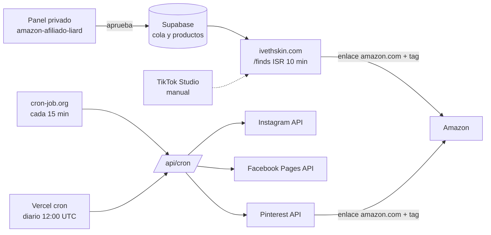

# Arquitectura y decisiones

## Resumen

Amazon Affiliate Command es un panel privado (Next.js 16 en Vercel, con Supabase) para preparar, aprobar y publicar contenido de afiliado en Pinterest, Instagram y Facebook. La misma app sirve la tienda pública **ivethskin.com**: `proxy.ts` reescribe los dominios de `SHOP_HOSTS` a `/finds`. Un scheduler externo llama a `/api/cron` cada 15 minutos.

## Integraciones (verificadas en el código)

| Canal | Módulo | Estado |
|---|---|---|
| Pinterest | `src/lib/server/pinterest.ts`, `operations.ts` | Publica y lee métricas por API |
| Instagram | `src/lib/server/instagram.ts` | Reels, foto diaria y carrusel |
| Facebook | `src/lib/server/facebook.ts` | Reels y posts con enlace en la Página |
| TikTok | — | Sin integración; se publica a mano |

## Decisiones (2026-10-21)

1. **La tienda no rompe la compilación cuando falta la base de datos.** `shopItems()` devuelve una lista vacía si `configured()` es falso. *Por qué:* las claves de Supabase están solo en Producción, así que los builds de vista previa fallaban. *Costo:* en una vista previa la tienda sale vacía. *Revisar si* se agrega a Preview una clave de solo lectura.
2. **Datos estructurados sin `Product`.** Solo se usan Organization, WebSite, BreadcrumbList e ItemList. *Por qué:* el marcado Product sin precio queda incompleto para Google, y la tienda no muestra precios (regla de Amazon).
3. **Medición por tracking ID de Amazon, no por redirección propia.** `AMAZON_CHANNEL_TAGS` asigna un tracking ID por canal. Los Pins lo usan al publicar; la tienda lo cambia en el navegador según la fuente de la visita (utm o referrer). *Por qué:* Amazon reporta pedidos y comisiones por tracking ID y ASIN, y no ofrece una API de reportes para afiliados. Así el enlace sigue siendo amazon.com, sin ocultarlo. *Costo:* la granularidad es por canal, no por Pin (Amazon permite hasta 100 IDs).
4. **El aviso va en cada tarjeta** ("#ad · I may earn a commission from this link."), además de la barra superior, la nota bajo el botón de compra y el pie de página. Reemplazó a `GridNote` (una línea por grupo) para no duplicar avisos.
5. **Las fotos se describen con exactitud:** "ours; some made with AI".
6. **Cada post de Instagram y Facebook se reserva y se envía una sola vez.** `claim_instagram_posts` / `claim_facebook_posts` con `FOR UPDATE SKIP LOCKED` y `claim_token`. Un timeout o 5xx deja el post `uncertain` y se reconcilia leyendo su estado en la red, sin reenviarlo a ciegas. *Costo:* un post con enlace incierto espera al dueño.
7. **Una sola pasada del cron a la vez** (`cron_leases`, turno de 330 s). *Por qué:* cron-job.org y el cron diario de Vercel coinciden a las 12:00 UTC, y la planificación del día (`planPhotos`, `planLinks`) lee y luego inserta, así que dos pasadas juntas podían crear dos posts del mismo día. *Costo:* si una pasada se cuelga, las siguientes se saltan hasta que venza el turno (máximo 330 s). *Revisar si* el cron necesita más de 300 s por pasada.

## Despliegue

- `main` es producción: cada push a `main` despliega ivethskin.com y el panel.
- Las ramas generan vistas previas en Vercel. Sin claves de la base de datos, la vista previa muestra la tienda vacía, pero el diseño y el marcado se pueden revisar.

## Plan por fases

| Fase | Entregable | Estado |
|---|---|---|
| 1 | Builds de vista previa, SEO (JSON-LD, tarjeta de X), avisos junto a los enlaces, textos exactos sobre las fotos, tracking ID por canal (código) | Esta rama |
| 2 | Crear los tracking IDs en Associates, configurar `AMAZON_CHANNEL_TAGS`, poner `?utm_source=` en los enlaces de las biografías | Requiere al usuario |
| 3 | Importar el CSV de Amazon (pedidos y ganancias por tracking ID y ASIN) y mostrar compras por canal y producto junto a clics e impresiones | Siguiente tarea de código |
| 4 | Versión en español (`/es`, hreflang, textos traducidos a mano) | Pendiente |
| 5 | Pins de video con el mismo Reel | Pendiente |
